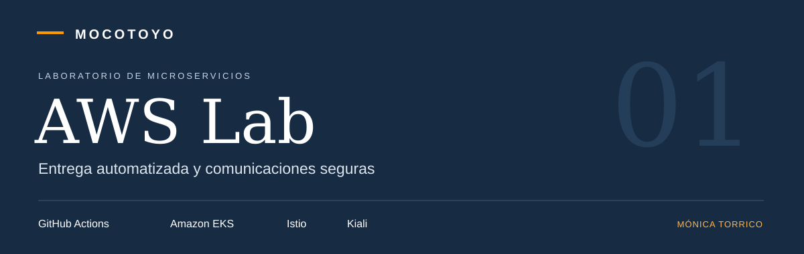
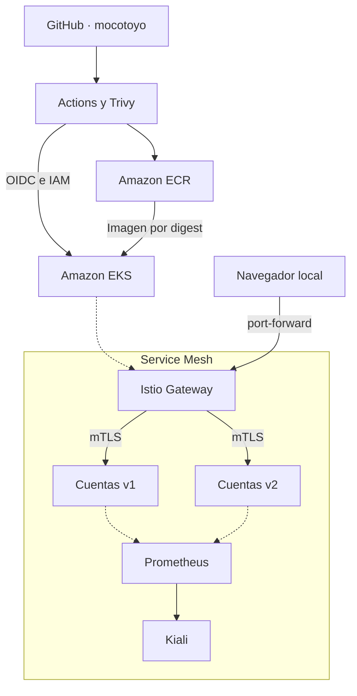

<p align="center">
  
</p>

# AWS Lab · CI/CD y Service Mesh

**Un laboratorio para publicar una aplicación en EKS, proteger el tráfico con Istio y observar sus versiones en Kiali.**

Mónica Torrico · [@mocotoyo](https://github.com/mocotoyo) · Kubernetes y microservicios


[Inicio rápido](#inicio-rapido) · [Arquitectura](#arquitectura) · [Costos](#costos) · [Demostración](#demostracion) · [Guía completa](docs/GUIA_COMPLETA.md) · [DELETE](#eliminar)

---

<a id="propuesta"></a>
## 01 / Qué vas a demostrar

| Capacidad | Ejercicio | Evidencia esperada |
|---|---|---|
| **Entrega automatizada** | GitHub Actions construye, Trivy analiza y ECR almacena la imagen | Pipeline y digest de la imagen |
| **Tráfico progresivo** | Istio distribuye solicitudes entre v1 y v2 | Conteo canary y grafo de Kiali |
| **Comunicaciones seguras** | mTLS STRICT y autorización por identidad y método | Solicitudes permitidas y rechazadas |
| **Operación del laboratorio** | Recreación de pods, rollback y eliminación | Nueva réplica y cierre verificado |

> [!NOTE]
> **Estado del proyecto:** kit preparado con comprobaciones locales de código. La integración completa en AWS sigue pendiente de ejecución. Las cifras y respuestas de ejemplo no son resultados medidos del laboratorio.

<a id="costos"></a>
## 02 / Un laboratorio con costo visible

| **USD 0 en AWS** | **≈ USD 0,19 por hora** | **USD 2 de reserva** |
|---|---|---|
| Ensayo con `kind` en tu computadora | EKS estándar y un nodo `t3.large` | Margen orientativo para una sesión corta |

**La recomendación:** ensayar localmente y reservar EKS para comprobar OIDC, ECR y el pipeline durante unas tres horas.

La estimación AWS usa `us-east-1`, un nodo, 20 GiB gp3 y una IPv4 pública. No incluye NAT Gateway ni balanceador público. Tarifas de referencia del 24/11/2026, sin impuestos, créditos ni consumos adicionales. Una sesión de tres horas, más limpieza y reserva, da aproximadamente **USD 1,07** en el planificador.

> [!WARNING]
> **USD 2 no es un límite duro.** Budgets avisa con retraso. El temporizador local depende del equipo y las credenciales. La protección principal es eliminar los recursos y comprobar el cierre. Si queda activo 24 horas, la base estimada ronda USD 4,58.

[Ver desglose, alertas y tiempos](docs/GUIA_COMPLETA.md#1-costos-antes-de-crear-recursos)

<a id="arquitectura"></a>
## 03 / Arquitectura



El pipeline entrega software. El gateway recibe las solicitudes del túnel local. Istio protege el tráfico hacia los pods y aplica las reglas de distribución. **La prueba no expone una entrada pública.**

<a id="inicio-rapido"></a>
## 04 / Inicio rápido

### Primero, el ensayo local

Descomprimir el paquete y entrar en `aws-eks-mesh-lab/`. Después de publicarlo, también podrás clonarlo desde `mocotoyo/aws-eks-mesh-lab`.

```bash
cp .env.lab.example .env.lab
bash setup.sh --plan
bash setup.sh --local
```

Requiere Docker, kind, kubectl, Helm, Python 3 y curl. Asignar recursos suficientes a Docker y revisar la compatibilidad Kubernetes/Istio. [Preparación completa](docs/GUIA_COMPLETA.md#4-preparacion).

### Después, una sesión corta en AWS

```bash
# Editar antes .env.lab: cuenta esperada, correo y parámetros del laboratorio.
bash setup.sh --plan
bash setup.sh --aws --apply
```

Este paso **crea recursos facturables**. Requiere acceso AWS/GitHub y completar los prerrequisitos de [OIDC y creación del entorno](docs/GUIA_COMPLETA.md#7-github-y-oidc). No ejecutar solamente copiando los comandos de la portada.

<a id="demostracion"></a>
## 05 / Recorrido de la demostración

| Paso | Qué haces | Qué compruebas |
|---|---|---|
| **01 · Publicar** | Commit y push a `main` | Construcción, escaneo y rollout |
| **02 · Observar** | Abrir Kiali y generar solicitudes | Topología y tráfico reciente |
| **03 · Promover** | Probar 90/10, 50/50 y 0/100 | Distribución entre versiones |
| **04 · Proteger** | Probar mTLS y AuthorizationPolicy | Identidad y método autorizados |
| **05 · Recuperar** | Recrear un pod y revertir un cambio | Comportamiento de recuperación |
| **06 · Cerrar** | Ejecutar DELETE y revisar residuos | Fin de los recursos facturables del kit |

**Canary de ejemplo, en local:**

```bash
bash scripts/canary.sh local 90 10
python3 scripts/traffic.py --count 200

bash scripts/canary.sh local 50 50
python3 scripts/traffic.py --count 200

bash scripts/canary.sh local 0 100
python3 scripts/traffic.py --count 200
```

Para AWS, cambiar `local` por `aws`. El conteo es una muestra y la configuración necesita propagarse. Mantener el gateway abierto con port-forward. [Ejercicios paso a paso](docs/GUIA_COMPLETA.md#10-acceso-a-la-aplicacion).

<a id="eliminar"></a>
## 06 / Eliminar la prueba

[](https://github.com/mocotoyo/aws-eks-mesh-lab/actions/workflows/delete-lab.yml)

**El botón abre GitHub Actions.** Después de publicar el repositorio y configurar el rol DELETE: pulsar **Run workflow**, elegir `main` y confirmar `mocotoyo-mesh-demo` o tu `LAB_ID`.

Desde la terminal:

```bash
bash cleanup.sh --aws --apply       # Elimina los recursos AWS del kit
bash cleanup.sh --local --apply     # Elimina únicamente kind local
```

Son alternativas para cada modalidad. Borrar pods o reducir nodos a cero mantiene el costo de EKS. El presupuesto y el proveedor OIDC compartido se conservan. [Eliminación, límites y recuperación](docs/GUIA_COMPLETA.md#16-eliminar-el-laboratorio).

<a id="documentacion"></a>
## 07 / Documentación

| Documento | Cuándo abrirlo |
|---|---|
| [**Guía completa del laboratorio**](docs/GUIA_COMPLETA.md) | Configuración y comandos de las 18 secciones |
| [Guion del presentador](docs/GUION_PRESENTADOR.md) | Preparar la exposición y ordenar la demo |
| [Recuperación y limpieza](docs/RECUPERACION.md) | Resolver una creación o eliminación parcial |
| [Estado de validación](docs/VALIDACION.md) | Distinguir las comprobaciones locales de las pruebas pendientes |
| [Publicación y estilo del repositorio](docs/PUBLICAR_GITHUB.md) | Subir el proyecto y conservar la apariencia de la portada |

<details>
<summary><strong>Estructura del proyecto</strong></summary>

```text
aws-eks-mesh-lab/
├── README.md
├── setup.sh
├── cleanup.sh
├── .env.lab.example
├── app/
├── k8s/
├── scripts/
├── tests/
├── docs/
│   ├── assets/
│   ├── GUIA_COMPLETA.md
│   └── PUBLICAR_GITHUB.md
└── .github/workflows/
    ├── deploy.yml
    └── delete-lab.yml
```

</details>

---

**Mónica Torrico · mocotoyo**  
Laboratorio de Kubernetes y microservicios. Práctica local primero y cierre verificado al finalizar AWS.
