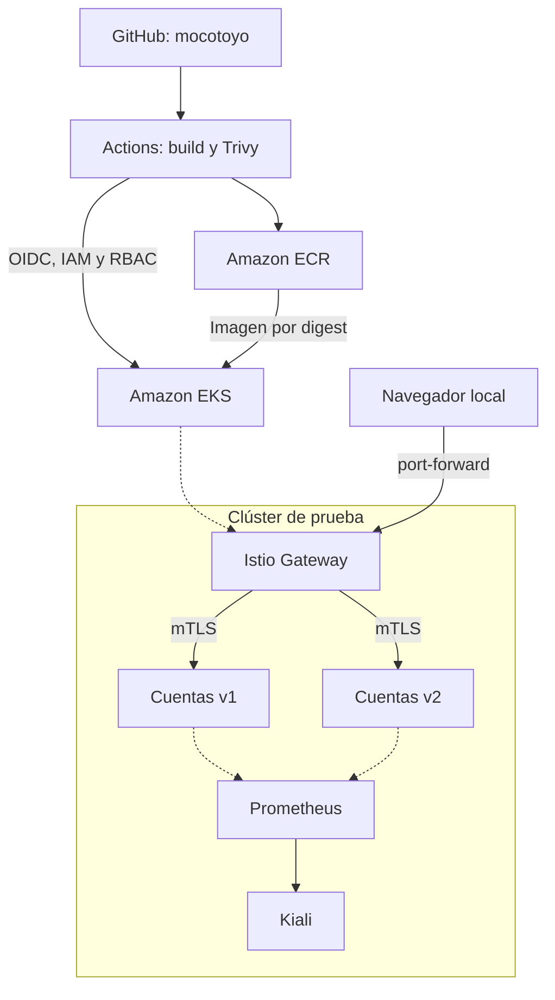
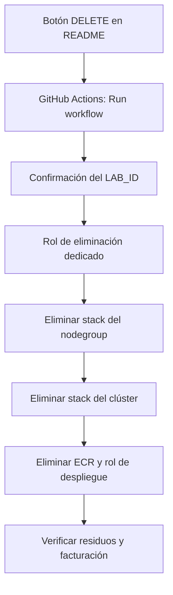
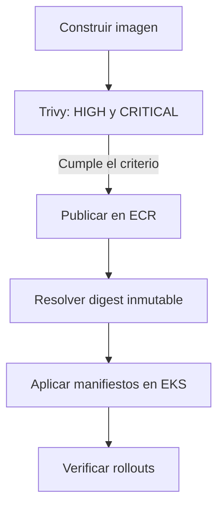

<div align="center">

# mocotoyo AWS Lab

### GitHub Actions · Amazon EKS · Istio · Kiali

Una prueba de microservicios con control de costos desde el primer paso


**Mónica Torrico** · [@mocotoyo](https://github.com/mocotoyo)

[Inicio rápido](#6-practica-local-recomendada) · [Costos](#1-costos-antes-de-crear-recursos) · [Demostración](#11-kiali-y-prometheus) · [Eliminar](#16-eliminar-el-laboratorio)

[](https://github.com/mocotoyo/aws-eks-mesh-lab/actions/workflows/delete-lab.yml)

</div>

> [!IMPORTANT]
> **La opción recomendada para practicar es local: USD 0 de consumo AWS.** EKS se reserva para una sesión corta de integración con AWS. El botón DELETE funcionará después de publicar este repositorio y completar la configuración del rol de eliminación. El kit no ha desplegado recursos en tu cuenta.

> [!WARNING]
> **USD 2 es un umbral preventivo, no un límite de facturación garantizado.** AWS Budgets tiene retraso y no apaga EKS por alcanzar ese importe. El temporizador local requiere equipo/WSL encendido y credenciales vigentes. La eliminación puede tardar y puede fallar. Comprobar siempre el cierre.

---

## Contenido

1. [Costos antes de crear recursos](#1-costos-antes-de-crear-recursos)
2. [Arquitectura y flujo](#2-arquitectura-y-flujo)
3. [Qué incluye esta versión](#3-que-incluye-esta-version)
4. [Preparación](#4-preparacion)
5. [Versiones y seguridad](#5-versiones-y-seguridad)
6. [Práctica local recomendada](#6-practica-local-recomendada)
7. [GitHub y OIDC](#7-github-y-oidc)
8. [Creación de la prueba AWS](#8-creacion-de-la-prueba-aws)
9. [Primer pipeline](#9-primer-pipeline)
10. [Acceso a la aplicación](#10-acceso-a-la-aplicacion)
11. [Kiali y Prometheus](#11-kiali-y-prometheus)
12. [Promoción del canary](#12-promocion-del-canary)
13. [mTLS y autorización](#13-mtls-y-autorizacion)
14. [Recuperación y rollback](#14-recuperacion-y-rollback)
15. [Evidencias y guion](#15-evidencias-y-guion)
16. [Eliminar el laboratorio](#16-eliminar-el-laboratorio)
17. [Solución de problemas](#17-solucion-de-problemas)
18. [Siguientes pasos y fuentes](#18-siguientes-pasos-y-fuentes)

<a id="1-costos-antes-de-crear-recursos"></a>
## 1. Costos antes de crear recursos

### La elección que más ahorra

| Modalidad | Para qué sirve | Consumo AWS | Decisión recomendada |
|---|---|---:|---|
| Local con `kind` | Istio, canary, mTLS, AuthorizationPolicy y Kiali | **USD 0** | Ensayar aquí primero |
| EKS económico | OIDC, ECR, GitHub Actions y despliegue en AWS | **≈ USD 0,19/h** | Una sesión de 3 horas |
| EKS abandonado | Mismos recursos encendidos sin uso | **≈ USD 4,58/día** | Eliminar al terminar |

El modo local usa tu equipo y no reproduce EKS, IAM ni el acceso de un runner GitHub hospedado a un clúster local. No tiene cargo AWS, pero sí consume recursos locales. GitHub puede facturar minutos y almacenamiento según tu plan.

### Perfil AWS de esta prueba

| Recurso | Configuración económica | Referencia USD/h |
|---|---|---:|
| EKS | Un clúster con versión en soporte estándar | 0,1000 |
| EC2 | Un nodo `t3.large`, Linux On-Demand | 0,0835 |
| IPv4 pública | Una dirección del nodo | 0,0050 |
| EBS | 20 GiB gp3, rendimiento base | ≈ 0,0022 |
| ECR | Hasta 1 GB almacenado | ≈ 0,0001 |
| **Base estimada** | **Un nodo, sin NAT ni balanceador** | **≈ 0,1909** |

Referencias verificadas el **24 de noviembre de 2026**, usando `us-east-1` y 720 h/mes para prorratear almacenamiento. No incluyen impuestos, soporte contratado, transferencia adicional, servicios ajenos al kit ni cambios de tarifa. No se descuenta Free Tier ni créditos. Los distintos recursos pueden empezar y terminar su facturación en momentos diferentes.

| Tiempo de infraestructura | Base orientativa | Qué reservaría para la sesión |
|---|---:|---|
| 1 hora | USD 0,19 | Preparación local previa indispensable |
| 3 horas | USD 0,57 | **USD 2** con margen de creación/eliminación y extras |
| 4 horas | USD 0,76 | **USD 2** con margen, sin garantía de tope |
| 24 horas olvidado | USD 4,58 | Eliminar inmediatamente |
| 720 horas olvidado | USD 137,42 | Evitar mantenerlo durante el mes |

El planificador suma **0,5 h de limpieza y USD 0,40 de reserva**, además de la ventana configurada. Para `LAB_HOURS=3` calcula aproximadamente **USD 1,07**. Es un control previo, no mide el gasto real ni garantiza un máximo.

```bash
cp .env.lab.example .env.lab
bash setup.sh --plan
```

### Controles incluidos

| Control | Comportamiento | Límite práctico |
|---|---|---|
| `SESSION_LIMIT_USD=2` | Bloquea setup si la estimación lo supera | No aplica un tope a AWS |
| `LAB_HOURS=3` | Fija vencimiento y temporizador local | La eliminación consume tiempo adicional |
| Soporte EKS estándar | Rechaza versiones fuera de soporte estándar | Requiere AWS CLI actualizado |
| Upgrade policy `STANDARD` | Evita habilitar soporte extendido a futuro | No elimina el clúster |
| Un nodo, `maxSize: 1` | Evita ampliar capacidad desde el nodegroup | No es alta disponibilidad |
| T3 en modo `standard` | Evita excedentes de créditos CPU Unlimited | Puede reducir rendimiento sostenido |
| Sin NAT, ALB, NLB ni PVC | Evita esos recursos en este kit | No añadirlos durante la prueba |
| Kiali y Prometheus en memoria | Sin AMP, AMG, OpenSearch ni disco persistente | Pierdes las métricas al eliminar el pod |
| Etiquetas e inventario | Identifica recursos del laboratorio | No todos los tipos heredan tags automáticamente |
| DELETE desde GitHub | Elimina recursos inventariados con rol dedicado | Requiere GitHub disponible y permisos válidos |

**AWS Budgets:** el setup crea una alerta mensual para toda la cuenta por `MONTHLY_BUDGET_USD=2`, con avisos de gasto real al **25 %, 50 %, 80 % y 100 %**. No depende de etiquetas de facturación recién activadas. Otros proyectos también cuentan hacia ese presupuesto. Si ya consumiste el umbral durante el mes, el aviso puede no repetirse. Monitorización sin acciones de presupuesto ni informes diarios de pago. No crea suscripciones a SNS.

**Etiquetas:** `proyecto=mesh-lab`, `lab-id=mocotoyo-mesh-demo`, `owner=mocotoyo` y `expires-at=<epoch>`. La fecha **no provoca borrado automático por sí sola**. `tag-and-limit.sh` etiqueta explícitamente el nodo, VPC y volúmenes raíz. CloudFormation propaga las etiquetas donde el tipo lo admite. Los roles incluyen etiquetas de pertenencia. No se etiqueta ni se elimina el proveedor OIDC compartido.

<details>
<summary><strong>Cuánto tiempo separar para la prueba</strong></summary>

Estimaciones de planificación, no tiempos medidos ni SLA.

| Etapa | Tiempo estimado | Impacto sobre costo AWS |
|---|---:|---|
| Instalación de herramientas, lectura y ensayo local | 30–60 min o más | Sin recursos AWS del kit |
| GitHub, revisión OIDC y presupuesto | 10–20 min | Sin EKS todavía |
| Creación EKS y nodo | 20–45 min | Los recursos empiezan a generar cargos al aprovisionarse |
| Istio, Kiali y configuración | 10–20 min | Clúster activo |
| Pipeline e imagen | 5–15 min | Clúster activo y posible costo GitHub |
| Demostración | 30–45 min | Clúster activo |
| DELETE y verificación | 15–40 min o más | Cobro hasta eliminación efectiva de cada recurso |

Separar una ventana AWS de **3 horas** después de ensayar localmente. Si algo se atasca, priorizar DELETE antes de seguir depurando con infraestructura encendida.

</details>

<a id="2-arquitectura-y-flujo"></a>
## 2. Arquitectura y flujo



**Camino de despliegue:** GitHub construye la imagen, Trivy la analiza, ECR la guarda y el pipeline aplica los manifiestos en EKS. **Camino de uso:** el navegador entra por el túnel local al gateway de Istio. mTLS protege el tramo del gateway a los pods. No se publica una URL abierta en Internet.



<a id="3-que-incluye-esta-version"></a>
## 3. Qué incluye esta versión

| Área | Componentes | Demostración |
|---|---|---|
| CI/CD | GitHub Actions y Amazon ECR | Cambio de código, escaneo y rollout |
| Mesh | Istio con sidecars | 90/10, 50/50 y 0/100 |
| Cifrado | `PeerAuthentication STRICT` | Rechazo de cliente sin mesh |
| Autorización | `AuthorizationPolicy` por ServiceAccount y método | GET permitido y POST rechazado |
| Observabilidad | Kiali y Prometheus | Topología, tráfico y telemetría de seguridad |
| Operación | Probes y Deployments | Recreación de pods y rollback |
| Costos | Plan, Budgets, TTL local e inventario | Creación contenida y DELETE |

**Fuera del alcance actual:** Keycloak/JWT, Argo CD, trazas distribuidas, Vault, backup, alta disponibilidad y exposición productiva. Esta versión incorpora Kiali y autorización básica, que en el deck original aparecían como ampliaciones.

```text
aws-eks-mesh-lab/
├── README.md                    # Versión pública mocotoyo
├── setup.sh                     # Plan, ensayo local o creación AWS
├── cleanup.sh                   # Eliminación desde terminal
├── .env.lab.example             # Parámetros sin credenciales
├── app/                         # Aplicación y Dockerfile
├── k8s/                         # Deployments, mesh y autorización
├── scripts/                     # Automatización, costos y evidencias
├── .github/workflows/
│   ├── deploy.yml               # Construcción, escaneo y despliegue
│   └── delete-lab.yml           # Botón DELETE
├── .github/actions-lock.json    # SHAs consultados en repositorios oficiales
├── docs/
│   ├── GUIA_COMPLETA.md
│   ├── GUION_PRESENTADOR.md
│   ├── RECUPERACION.md
│   └── VALIDACION.md
└── tests/                       # Comprobaciones sin crear recursos AWS
```

<a id="4-preparacion"></a>
## 4. Preparacion

Trabajar en Ubuntu o WSL2. Instalar desde los sitios oficiales las herramientas requeridas:

| Modalidad | Herramientas |
|---|---|
| Local | Docker funcionando, kind, kubectl, Helm 3, Python 3, curl y Git |
| AWS | Las anteriores excepto kind/Docker local, más AWS CLI v2, eksctl, gh, jq y flock |
| Evidencias del mesh | istioctl de la misma versión que Istio |
| Temporizador local | systemd de usuario disponible en Ubuntu/WSL2 |

```bash
git --version
python3 --version
kubectl version --client
helm version
docker info                         # Solo ensayo local
kind version                        # Solo ensayo local
aws --version                       # Solo AWS
eksctl version                      # Solo AWS
gh auth status                      # Solo AWS/GitHub
```

No instalar automáticamente “el último kubectl” sin comprobar compatibilidad con el clúster. No publicar claves, tokens, kubeconfig ni archivos de `.state/`.

Después de publicar el repositorio, podrá clonarse así:

```bash
git clone https://github.com/mocotoyo/aws-eks-mesh-lab.git
cd aws-eks-mesh-lab
cp .env.lab.example .env.lab
```

Hasta publicarlo, descomprimir el ZIP y entrar en `aws-eks-mesh-lab/`. **No se ha creado ni publicado este repositorio desde el entorno de preparación.**

<a id="5-versiones-y-seguridad"></a>
## 5. Versiones y seguridad

La configuración de partida usa **Kubernetes 1.35 e Istio 1.32.0**. El setup AWS consulta `describe-cluster-versions` y solo continúa con `STANDARD_SUPPORT`. Verificar además la matriz de compatibilidad de Istio y la disponibilidad de la versión elegida en la región.

```bash
aws eks describe-cluster-versions --region us-east-1 \
  --query 'clusterVersions[].[clusterVersion,status,endOfStandardSupportDate]' --output table
```

No reutilizar las versiones antiguas `1.33 / 1.27.3` del texto inicial sin comprobar su soporte actual.

- Acciones externas fijadas por **SHA completo**. Revisar `.github/actions-lock.json`.
- Dependabot propone actualizaciones de acciones y de la imagen base.
- Trivy bloquea HIGH y CRITICAL, **incluidos los hallazgos sin corrección**. Si bloquea, actualizar la base y revisar el resultado. No ocultar errores para obtener un workflow verde.
- ECR usa etiquetas inmutables y el despliegue usa **digest**. Un reintento añade `run_attempt` para evitar sobrescribir la etiqueta previa.
- La imagen base Python todavía usa una etiqueta. Antes de una demo estable, fijar un digest corregido y escaneado. Fijar acciones de primer nivel no garantiza por sí solo que todas sus dependencias transitivas sean inmutables.
- El pipeline dispone de permisos de despliegue limitados al namespace. Un **rol distinto** elimina solo los recursos que inventaría la prueba.
- El script OIDC compara `iss`, `aud` y `sub` sin imprimir tokens. AWS valida su firma al asumir el rol.

<a id="6-practica-local-recomendada"></a>
## 6. Practica local recomendada

Asignar a Docker aproximadamente **8–12 GB de RAM** para el ensayo. Es una recomendación de capacidad, no una medición del consumo. Verificar que el Kubernetes predeterminado de kind sea compatible con tu versión de Istio.

```bash
bash setup.sh --plan        # Solo estimación, no crea recursos
bash setup.sh --local       # Crea kind, Istio, la app y Kiali/Prometheus
export KUBECONFIG="$PWD/.state/kubeconfig-local"
kubectl get pods -A
```

Si quieres omitir Kiali al comenzar, cambiar `ENABLE_KIALI=false` en `.env.lab`. Para añadirlo luego:

```bash
bash scripts/observability.sh local
```

La primera imagen es `cuentas:local`, construida y cargada directamente en kind. Para eliminar el ensayo local:

```bash
bash cleanup.sh --local --apply
```

<a id="7-github-y-oidc"></a>
## 7. GitHub y OIDC

```bash
gh auth login
# Usar el acceso corporativo aprobado, por ejemplo SSO:
aws configure sso
aws sso login --profile TU_PERFIL
export AWS_PROFILE=TU_PERFIL
aws sts get-caller-identity
```

Editar `.env.lab` con tu cuenta de **laboratorio**, correo, región y presupuesto. El usuario GitHub ya está configurado como `mocotoyo`. No usar una cuenta productiva.

### Proveedor OIDC compartido

Comprobar si existe:

```bash
aws iam list-open-id-connect-providers
```

Solo si falta el proveedor de GitHub, crearlo una vez:

```bash
aws iam create-open-id-connect-provider \
  --url https://token.actions.githubusercontent.com \
  --client-id-list sts.amazonaws.com
```

No eliminarlo al limpiar el laboratorio: puede dar servicio a otros repositorios.

### Subject explícito

Para evitar depender del formato predeterminado de los repositorios nuevos, `github.sh` personaliza el subject con:

```text
repository_owner_id:OWNER_ID:repository_id:REPO_ID:environment:lab:ref:refs/heads/main
```

Los IDs reales se consultan mediante la API de GitHub. La confianza IAM exige ese valor exacto y `aud=sts.amazonaws.com`. Se usa el entorno `lab`, restringido a `main`. **Esto cambia la configuración OIDC del repositorio de prueba**. Si el repositorio ya tiene integraciones, usar uno nuevo para este lab.

El script prepara el repositorio, el entorno, la restricción de rama y OIDC **antes de crear EKS**. Si tu plan GitHub no permite ese entorno con el tipo de repositorio elegido, el setup se detiene antes de aprovisionar el clúster. El ejemplo externo usa repositorio público, sin credenciales ni estado local.

<a id="8-creacion-de-la-prueba-aws"></a>
## 8. Creacion de la prueba AWS

Después de ensayar localmente y eliminar kind si necesitas liberar recursos:

```bash
# Editar primero .env.lab
bash setup.sh --plan
bash setup.sh --aws --apply
```

El setup:

1. Verifica cuenta esperada, herramientas, costo previsto y soporte estándar de EKS.
2. Verifica nombres exclusivos. No adopta infraestructura preexistente.
3. Prepara GitHub, OIDC y un inventario local antes de crear infraestructura.
4. Crea o conserva un presupuesto compatible y arma el temporizador local.
5. Crea ECR, rol de despliegue, VPC sin NAT y EKS con un nodo.
6. Aplica modo CPU `standard`, etiquetas y la política de soporte estándar.
7. Instala Istio, RBAC y Kiali/Prometheus.
8. Configura variables GitHub y un rol DELETE con ARNs inventariados.

> [!CAUTION]
> El temporizador **no vive en AWS**. Cerrar WSL, apagar/suspender la computadora, perder conexión o dejar expirar SSO puede impedir o retrasar la limpieza. Si falla una operación, conserva `.state/` y ejecuta DELETE. El botón GitHub permite eliminar aunque tu equipo esté apagado, pero requiere que alguien lo ejecute.

El setup exige systemd de usuario. En WSL2 puede ser necesario habilitar systemd y reiniciar WSL antes de comenzar. `ALLOW_NO_TIMER=true` permite una excepción explícita para una sesión supervisada, pero elimina esa protección. El timer reintenta los fallos cada cinco minutos mientras el equipo esté disponible. No es un corte garantizado de gasto.

Si la creación falla, no repetir setup a ciegas: el inventario permanece para recuperar o eliminar. Ver [recuperación](RECUPERACION.md).

<a id="9-primer-pipeline"></a>
## 9. Primer pipeline

Publicar el contenido ya preparado. La versión pública utiliza la marca mocotoyo:

```bash
# Solo si aún no inicializaste Git en este directorio:
git init -b main
git add .
git commit -m "Lab EKS e Istio con control de costos y DELETE"
git remote add origin https://github.com/mocotoyo/aws-eks-mesh-lab.git
git push -u origin main
```

Si `origin` ya existe, revisarlo con `git remote -v` y omitir `git remote add`. Si el repositorio remoto ya tiene commits, integrarlos primero. No forzar un push que sobrescriba trabajo existente.

```bash
gh workflow run deploy.yml --repo mocotoyo/aws-eks-mesh-lab --ref main
gh run list --repo mocotoyo/aws-eks-mesh-lab --limit 5
```

El push de archivos de app/mesh también dispara el workflow. No iniciar otra ejecución si la del push ya está en curso. El job tiene un máximo de 20 min y no despliega si el TTL venció. El pipeline solo despliega aplicaciones: **no puede crear otro clúster EKS**.



<a id="10-acceso-a-la-aplicacion"></a>
## 10. Acceso a la aplicacion

Seleccionar **un solo modo por terminal**:

```bash
# Para local:
export KUBECONFIG="$PWD/.state/kubeconfig-local"
# Para AWS, usar en su lugar:
# export KUBECONFIG="$PWD/.state/kubeconfig-aws"

kubectl get pods -n mesh-lab
kubectl -n istio-ingress port-forward svc/istio-ingressgateway 8080:80
```

Mantener el port-forward abierto y, en otra terminal:

```bash
curl --fail http://127.0.0.1:8080/
```

Respuesta de ejemplo, **no evidencia de una ejecución AWS**:

```json
{"servicio":"cuentas","version":"v1","pod":"cuentas-v1-..."}
```

El navegador accede a `http://127.0.0.1:8080`. mTLS protege el tráfico desde el gateway a los workloads. El túnel local no demuestra TLS de una entrada pública.

<a id="11-kiali-y-prometheus"></a>
## 11. Kiali y Prometheus

```bash
# Solo si no los instaló setup:
bash scripts/observability.sh local    # Cambiar local por aws cuando corresponda
```

En otra terminal con el kubeconfig correcto:

```bash
kubectl -n istio-system port-forward svc/kiali 20001:20001
```

Abrir `http://127.0.0.1:20001`. Si la configuración concreta del addon habilita TLS, usar el esquema indicado por su Service/configuración. Se utiliza el addon de evaluación de la misma versión de Istio. Kiali permanece accesible solo por el túnel local.

Generar tráfico suave mientras observas:

```bash
python3 scripts/traffic.py --count 300 --delay 0.5
```

En Kiali:

1. Seleccionar el namespace `mesh-lab`.
2. Abrir la vista de topología/grafo y una ventana reciente, por ejemplo 1–5 minutos.
3. Ver las versiones v1/v2 y el flujo desde el gateway. Ajustar el agrupamiento por workload o versión si aparecen agrupadas.
4. Activar etiquetas de porcentaje de tráfico y las opciones de seguridad disponibles en esa versión.
5. Comparar el tráfico observado con los pesos del canary.

**El grafo necesita tráfico y tiempo de scrape.** El indicador de mTLS puede variar por versión de Kiali y configuración de telemetría. El candado es una ayuda visual, no reemplaza las pruebas de conexión. Si el gráfico está vacío, revisar Prometheus, time range y la generación de solicitudes.

Los addons usan almacenamiento efímero, con retención Prometheus acotada a una hora y 256 MB. No incluyen Grafana administrado, AMP, OpenSearch ni Jaeger.

<a id="12-promocion-del-canary"></a>
## 12. Promocion del canary

```bash
bash scripts/canary.sh local 90 10
python3 scripts/traffic.py --count 200

bash scripts/canary.sh local 50 50
python3 scripts/traffic.py --count 200

bash scripts/canary.sh local 0 100
python3 scripts/traffic.py --count 200

# Volver al inicio:
bash scripts/canary.sh local 90 10
```

Para EKS, sustituir `local` por `aws`. El script comprueba que los pesos suman 100, actualiza `k8s/mesh.yaml` y lo aplica. Los cambios del grafo pueden tardar por la ventana de agregación.

| Configuración | Qué esperar en una muestra |
|---|---|
| 90/10 | Ambas versiones, v1 predominante |
| 50/50 | Ambas versiones con proporción aproximada |
| 0/100 | Solo v2 después de propagarse la configuración |

No interpretar 200 solicitudes como una validación estadística de producción. Para que GitHub conserve la configuración, commit/push de `k8s/mesh.yaml` después del ejercicio. El siguiente deploy aplica lo declarado en Git.

<a id="13-mtls-y-autorizacion"></a>
## 13. mTLS y autorizacion

### 13.1 Cliente sin mesh

Ejecutar con el kubeconfig del modo elegido y después de desplegar la aplicación:

```bash
kubectl create namespace sin-mesh
IMAGE=$(kubectl -n mesh-lab get deployment cuentas-v1 \
  -o jsonpath='{.spec.template.spec.containers[0].image}')
kubectl -n sin-mesh run cliente --image="$IMAGE" --restart=Never \
  --command -- python -c 'import time; time.sleep(7200)'
kubectl -n sin-mesh wait --for=condition=Ready pod/cliente --timeout=180s
kubectl -n sin-mesh get pod cliente -o jsonpath='{.spec.containers[*].name}'
```

Debe aparecer un solo contenedor, sin `istio-proxy`. En local, el nombre de la imagen cargada es `cuentas:local`. En EKS los nodos descargan el digest desde ECR.

```bash
# STRICT: la conexión debe fallar.
kubectl -n sin-mesh exec cliente -- python -c \
  'import urllib.request; print(urllib.request.urlopen("http://cuentas.mesh-lab.svc.cluster.local:8080/",timeout=5).read())'
```

Para comparar con PERMISSIVE antes de aplicar AuthorizationPolicy:

```bash
kubectl -n mesh-lab patch peerauthentication strict --type merge \
  -p '{"spec":{"mtls":{"mode":"PERMISSIVE"}}}'
# Esperar propagación y repetir la solicitud: debe responder.

# Restaurar SIEMPRE:
kubectl apply -f k8s/mesh.yaml
# Esperar propagación y repetir: debe volver a fallar.
```

Si ya aplicaste `k8s/authorization.yaml`, retirarla temporalmente con `kubectl delete -f k8s/authorization.yaml` para aislar esta prueba. Así se evita atribuir un rechazo de autorización a mTLS. Restaurar los controles al terminar.

### 13.2 Autorización por ServiceAccount y método

```bash
bash scripts/auth-test.sh local         # O aws
```

El script crea dos clientes con sidecar y aplica una política ALLOW:

| Identidad | Método | Resultado esperado |
|---|---|---|
| `pagos` | GET | HTTP 200 |
| `pagos` | POST | HTTP 403 |
| `no-autorizado` | GET | HTTP 403 |
| Gateway `mesh-gateway` | GET | Acceso al demo permitido |

La política comprueba identidades mTLS con trust domain `cluster.local`. Mantener STRICT. El nombre de la ServiceAccount del gateway está fijado por Helm. Si lo cambias, actualizar también la política.

En local, los clientes usan la imagen ya cargada en kind. Si el runtime intenta descargarla con la política por defecto, verificar `imagePullPolicy` y mantener la etiqueta `local`, que no activa `Always`.

### 13.3 Confirmación visual

Volver al grafo, generar tráfico y revisar errores. **mTLS cifra y autentica el workload. AuthorizationPolicy decide si esa identidad y ese método pueden entrar.** Keycloak/JWT queda para otra fase.

<a id="14-recuperacion-y-rollback"></a>
## 14. Recuperacion y rollback

```bash
kubectl delete pod -n mesh-lab -l app=cuentas,version=v2
kubectl rollout status deployment/cuentas-v2 -n mesh-lab --timeout=180s
```

El Deployment recrea el pod. Una réplica por versión y un único nodo no demuestran alta disponibilidad. Puede haber fallos transitorios durante el ejercicio.

En AWS, editar `app/app.py`, commit y push. Para revertir ese cambio, usar el SHA exacto del commit de aplicación:

```bash
git revert --no-edit SHA_DEL_CAMBIO_DE_APLICACION
git push
```

No usar `git revert HEAD` sin revisar qué commit estás revirtiendo. El pipeline publica una imagen nueva con el contenido anterior. En local, reconstruir la imagen con una etiqueta distinta, cargarla en kind y actualizar el Deployment para probar la reversión sin AWS.

<a id="15-evidencias-y-guion"></a>
## 15. Evidencias y guion

Con el gateway disponible por port-forward:

```bash
bash scripts/evidence.sh local           # O aws
```

Registra salidas reales de pods, servicios, configuración del mesh y conteo canary. Si `istioctl` está instalado, captura `proxy-status`. Guarda adicionalmente el resultado de autorización y DELETE. La carpeta `evidencias/` está excluida de Git para revisar metadatos antes de publicar.

- [Guion completo del presentador](GUION_PRESENTADOR.md)
- [Recuperación y eliminación manual](RECUPERACION.md)
- [Estado de validación](VALIDACION.md)

No publicar resultados esperados como si fueran mediciones. Después de ejecutar AWS, añadir una sección “Resultados de la sesión” con fecha, región, duración y costo observado cuando la facturación se actualice.

<a id="16-eliminar-el-laboratorio"></a>
## 16. Eliminar el laboratorio

### Botón desde GitHub

[](https://github.com/mocotoyo/aws-eks-mesh-lab/actions/workflows/delete-lab.yml)

1. Abrir el botón después de publicar los workflows y finalizar setup.
2. Pulsar **Run workflow** en GitHub Actions.
3. Elegir `main`.
4. Escribir **`mocotoyo-mesh-demo`** en `confirm_lab`, o tu `LAB_ID` si lo cambiaste.
5. Ejecutar y seguir el log hasta completar la eliminación.

No es un botón que borre con un clic: abre una acción confirmada en GitHub. El job usa un rol distinto al de despliegue, con permisos sobre los stacks y recursos inventariados. No usa claves permanentes ni un rol administrador global.

El workflow elimina, en orden, el stack del nodegroup, el stack del clúster, ECR con sus imágenes y el rol de despliegue. Verifica que EKS ya no exista antes de cerrar. **Conserva el presupuesto de alertas, el proveedor OIDC compartido y el rol DELETE para permitir reintentos. Estos controles no generan cargo AWS por su mera existencia.** La limpieza local como administradora elimina también el rol DELETE.

**La eliminación vía CloudFormation presupone el alcance del kit: sin LB, PVC ni integraciones adicionales.** Si agregaste recursos por tu cuenta, eliminarlos y revisar dependencias antes de borrar el clúster. Un workflow verde no garantiza que nunca haya cargos tardíos o recursos ajenos al inventario.

### Un comando desde terminal

```bash
# Vista previa, no borra:
bash cleanup.sh --plan

# Eliminar AWS:
bash cleanup.sh --aws --apply

# Eliminar solo kind local:
bash cleanup.sh --local --apply
```

Si eliminas desde GitHub y luego deseas conciliar el estado local, ejecutar `cleanup.sh --aws --apply`: reconocerá los targets ya eliminados y realizará auditoría. Conserva el mismo `.state/` hasta terminar.

### Verificación de cierre

```bash
bash scripts/audit.sh
```

Revisa `evidencias/auditoria-delete.json`. El script consulta el nombre exacto del clúster, stacks, ECR, roles y recursos del inventario/VPC. No exige que toda tu cuenta esté vacía ni borra recursos ajenos por una búsqueda global.

**El costo EKS continúa hasta eliminar el control plane.** Escalar nodos a cero, detener EC2 o borrar pods no lo elimina. Si DELETE falla, revisar el evento `DELETE_FAILED` y continuar con [recuperación](RECUPERACION.md). No borrar `.state/` antes de verificar.

<a id="17-solucion-de-problemas"></a>
## 17. Solucion de problemas

| Síntoma | Qué revisar |
|---|---|
| Setup rechaza el presupuesto | `SESSION_LIMIT_USD`, ventana y tarifas. Ensayar local en lugar de aumentar el límite sin revisar |
| No hay systemd de usuario | Preparar WSL2/Ubuntu antes de crear recursos. No confiar en un timer que no existe |
| OIDC no coincide | Claims configurados, IDs, entorno `lab`, rama `main` y variable `OIDC_SUBJECT` |
| `Forbidden` al desplegar | Access entry, grupo y RBAC del namespace |
| Trivy bloquea | Actualizar y revisar imagen base. No convertir el escaneo en informativo |
| Kiali no muestra tráfico | Prometheus, scrape, ventana del grafo y solicitudes recientes |
| `Pending` u `OOMKilled` | Capacidad del nodo. Quitar observabilidad temporalmente antes de ampliar costo |
| Port-forward se corta | Reiniciarlo si cambió el pod o la conexión |
| DELETE devuelve `AccessDenied` | Revisar permisos limitados del rol y evento del stack. Usar administradora de la cuenta para recuperar |
| DELETE devuelve `DELETE_FAILED` | Dependencia residual o recurso adicional. Resolver y repetir eliminación |
| El temporizador no ejecutó | Equipo suspendido, sesión caducada o red. Ejecutar DELETE desde GitHub o terminal |

Si falta tiempo de la sesión, **eliminar primero y depurar localmente**. No dejar un clúster activo mientras investigas un error durante horas.

<a id="18-siguientes-pasos-y-fuentes"></a>
## 18. Siguientes pasos y fuentes

Una vez comprobada la base, ampliar en sesiones separadas: JWT con Keycloak, GitOps con Argo CD y pruebas de trazas. Cada ampliación requiere revisar su consumo y plan de eliminación.

### Referencias oficiales

- [Precios de Amazon EKS](https://aws.amazon.com/eks/pricing/)
- [EC2 T3 y precios de referencia](https://aws.amazon.com/ec2/instance-types/t3/)
- [Precios VPC e IPv4](https://aws.amazon.com/vpc/pricing/)
- [Precios EBS](https://aws.amazon.com/ebs/pricing/)
- [Precios ECR](https://aws.amazon.com/ecr/pricing/)
- [Precios AWS Budgets](https://aws.amazon.com/aws-cost-management/aws-budgets/pricing/)
- [Consideraciones y retraso de Budgets](https://docs.aws.amazon.com/cost-management/latest/userguide/bcm-lite-use-budget.html)
- [Ciclo de versiones EKS](https://docs.aws.amazon.com/eks/latest/userguide/kubernetes-versions.html)
- [OIDC de GitHub](https://docs.github.com/en/actions/reference/security/oidc)
- [Compatibilidad de Istio](https://istio.io/latest/docs/releases/supported-releases/)
- [Kiali para evaluación](https://kiali.io/docs/installation/quick-start/)

---

<div align="center">

**mocotoyo AWS Lab** · Documentación pública del laboratorio de Mónica Torrico

Práctica local primero. EKS durante una sesión corta. DELETE y verificación al finalizar.

</div>
